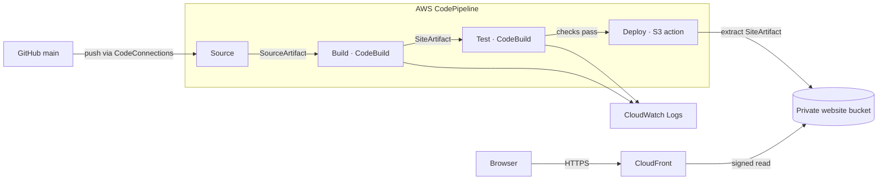

# Kevin Romero · Résumé delivery pipeline

A push to `main` starts AWS CodePipeline. It packages the résumé, tests the packaged site, and deploys it to a private S3 bucket. Visitors read the site over HTTPS through CloudFront. For the COMP4964 Assignment 4A submission, record a real push updating the live page and submit the recording link.

## Run it locally

From the repository root, run these commands in PowerShell with Python 3. If Windows uses the Python launcher, substitute `py -3` for `python`.

```powershell
python scripts/build.py
python scripts/test_site.py dist
python -m http.server 8000 --bind 127.0.0.1 --directory dist
```

Open <http://127.0.0.1:8000/>. Edit résumé content in `site/index.html` and layout in `site/styles.css`. Rebuild, rerun the tests, and refresh to preview changes. Press Ctrl+C in the server terminal when finished.

## How a commit reaches the browser



| Stage | Input and result |
| --- | --- |
| Source | AWS CodeConnections detects a GitHub branch update and supplies the repository at that revision as `SourceArtifact`. |
| Build | `buildspec.yml` runs the build script. CodeBuild packages the contents of `dist/` as `SiteArtifact`, with `index.html` at the artifact root. |
| Test | The same CodeBuild project runs `buildspec-test.yml`. It reads the tests from `SourceArtifact` and checks the actual `SiteArtifact` for missing page assets, broken internal navigation, and required HTML metadata. A failure stops that execution before deployment. |
| Deploy | The S3 action extracts the tested files into the website bucket. CloudFront reads this bucket using origin access control. The distribution disables caching for this demo, so a refresh can show the new revision. |

A separate private S3 bucket stores pipeline artifacts. The CodeBuild project sends build and test output to a CloudWatch log group with seven-day retention. [AWS CodeBuild action reference](https://docs.aws.amazon.com/codepipeline/latest/userguide/action-reference-CodeBuild.html) · [S3 deployment action](https://docs.aws.amazon.com/codepipeline/latest/userguide/action-reference-S3Deploy.html) · [CloudFront origin access control](https://docs.aws.amazon.com/AmazonCloudFront/latest/DeveloperGuide/private-content-restricting-access-to-s3.html)

## Deploy to AWS

1. **Push the project.** Verify that `git remote get-url origin` points to your GitHub repository. Review the résumé details you intend to publish, commit your files, and run `git push -u origin main`. Verify that GitHub shows the two buildspec files at the repository root.
2. **Choose the AWS account and Region.** Use an authenticated AWS CLI v2 profile for the assignment account. The examples use Oregon (`us-west-2`). The deploying identity needs access to the services in the template, including permission to create and pass its IAM roles and pass the GitHub connection. Check your account's plan, credits and service availability in Billing before creating the stack. This design uses a V1 pipeline and two CodeBuild runs per revision. Storage, traffic and logging also count toward usage. [CodePipeline pricing](https://aws.amazon.com/codepipeline/pricing/) · [CodeBuild pricing](https://aws.amazon.com/codebuild/pricing/)
3. **Authorize GitHub.** In the chosen Region, open Developer Tools → Settings → Connections. Choose **Create connection**, select **GitHub**, and connect. Select or install the AWS Connector for GitHub app, grant it access to `kevarome/DevOps-assignment4`, and finish the connection. Wait for **Available** and copy its ARN. If you already have an available connection with access to this repository in that Region, use its ARN. [AWS GitHub connection guide](https://docs.aws.amazon.com/codepipeline/latest/userguide/connections-github.html)
4. **Create the stack.** From the repository root, run the following in the same PowerShell session. Set the Region to match the connection. Confirm the account printed by the first AWS command belongs to the assignment. CloudFormation provisions the distribution, buckets, roles, logs, build project and pipeline, which can take several minutes.

```powershell
$region = 'us-west-2'
$stack = 'comp4964-resume'
$repo = 'kevarome/DevOps-assignment4'
$connection = Read-Host 'Paste the Available GitHub connection ARN'
aws sts get-caller-identity --region $region
aws cloudformation deploy --region $region --stack-name $stack `
  --template-file infra/pipeline.yml --capabilities CAPABILITY_IAM `
  --parameter-overrides "ConnectionArn=$connection" "FullRepositoryId=$repo" "BranchName=main"
```

5. **Verify the first deployment.** Retrieve the outputs below. Open CodePipeline in the same Region, choose the pipeline named in the outputs, and wait for the first execution to show all four stages as **Succeeded**. Open `WebsiteUrl` in a new tab and verify your name, résumé sections, and navigation.

```powershell
aws cloudformation describe-stacks --region $region --stack-name $stack `
  --query 'Stacks[0].Outputs[].[OutputKey,OutputValue]' --output table
```

## Record the assignment demo

1. **Capture the baseline.** Show the deployed CloudFront URL and point to the **Technical projects** heading. Keep this browser tab open.
2. **Walk through the pipeline.** Show the diagram and the successful baseline execution. Explain which branch triggers Source, what Build packages, how Test blocks a bad artifact, and where Deploy puts the files. Open a CodeBuild log for an example of the checks.
3. **Make one visible change.** In `site/index.html`, change the heading text from **Technical projects** to **Selected technical projects**. Run the local build and tests, then commit only that change. Show the diff and the short commit ID on screen.

   ```powershell
   git diff -- site/index.html
   git add -- site/index.html
   git commit -m "Clarify selected technical projects heading"
   git rev-parse --short HEAD
   git push origin main
   ```

4. **Prove the push triggered delivery.** In CodePipeline, find the new execution that started after your push. Compare its source revision with the commit you just showed. Wait for Deploy to succeed and refresh the original CloudFront tab. Point to the new heading at the same URL.
5. **Report what worked.** Cover the website, Git source trigger, packaging, automated tests, deployment and logs. Identify any stages that failed or remain unverified in your account. The template implements build/test logging. Custom website health monitoring, alarms and notifications are outside this implementation. Upload your recording to a platform the grader can open, check the link in a signed-out window, and submit the **recording URL**.

## Maintain and troubleshoot

- **Content updates.** Edit files in `site/`, run the local commands, then push one focused commit per change. Keep tests and buildspecs under version control. To roll back a content edit, use `git revert <commit-id>` and push the resulting commit. Verify that revision in the pipeline and refresh the live site.
- **Infrastructure updates.** Edit `infra/pipeline.yml` and rerun the same CloudFormation deploy command. A normal website push only publishes the packaged web files. For renamed or removed assets, verify the old S3 keys separately. The S3 action uploads files from the current artifact and can leave older keys in the bucket.
- **Source fails or a push starts no run.** Check the remote, pushed branch, case-sensitive repository ID, connection Region and **Available** status. Confirm the GitHub app installation includes this repository. [AWS connection troubleshooting](https://docs.aws.amazon.com/dtconsole/latest/userguide/troubleshooting-connections.html)
- **Stack creation fails.** In CloudFormation → stack → **Events**, read the earliest failed resource's reason. Check the specific service permission or account restriction it names. A connection-related access error can require `PassConnection` for the deploying identity or `UseConnection` for the pipeline role. [AWS connection permissions](https://docs.aws.amazon.com/dtconsole/latest/userguide/security-iam.html)
- **Build or Test fails.** Open the failed action's details and follow the CodeBuild log to the first failing command. Rebuild locally from the same revision and run the tests on `dist`. For a missing buildspec, verify its path and capitalization in GitHub.
- **Website returns 403 or shows old content.** Use the CloudFront `WebsiteUrl`. Wait for a successful Deploy, check that `index.html` is at the root of `SiteBucketName`, then refresh. Confirm the execution's source revision matches your push. For a persistent 403, check the distribution's origin and the bucket policy's distribution ARN.

## Clean up after recording

1. Confirm the recording link works. Finish any running pipeline execution and pause further pushes during cleanup.
2. In the stack's **Outputs**, identify `SiteBucketName` and `ArtifactBucketName`. In S3, select each of those exact buckets and choose **Empty**. This removes the demo website and pipeline artifacts. CloudFormation requires empty buckets for deletion. [S3 bucket emptying](https://docs.aws.amazon.com/AmazonS3/latest/userguide/empty-bucket.html)
3. In CloudFormation, select this assignment stack and choose **Delete**. Follow its events until deletion completes, including the CloudFront distribution. If a bucket refilled, let the run finish, empty that bucket and retry deletion.
4. If you created a dedicated GitHub connection for this assignment, delete it under Developer Tools → Settings → Connections. Remove its GitHub app installation or repository access only if other projects do not use it. Verify that the assignment resources are gone in CloudFormation and check the account's Billing dashboard for usage.
